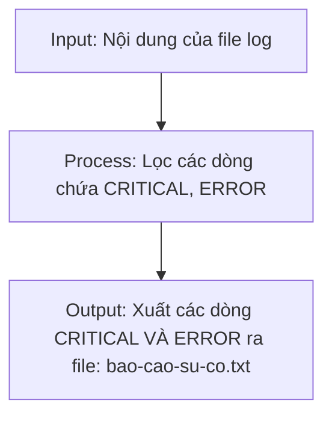

# SmartFarm Monitor
## Cách để chạy file script
```powershell
cd smartfarm-system\scripts
.\auto_report.ps1
```
> Nếu máy báo không chạy được thì cấp quyền bằng cách:
```powershell
Set-ExecutionPolicy RemoteSigned -Scope CurrentUser
```
> Sau đó chạy lại
```powershell
.\auto_report.ps1
``` 
## Các thiết bị
- [x] Intel NUC i3
- [ ] Raspberry Pi 4 Model B
- [ ] Mini PC Fanless N100

### Bảng thông số
|Tên|Đơn giá|Loại storage|
|:---|---:|:---|
|Raspberry Pi 4 Model B|1,450,000|SSD|
|Intel NUC i3|6,200,000|SSD|
|Oragne Pi 5|2,300,000|SSD|
## Mô hình IPO để đọc log

### DIKW
|Tầng|Nội dung|
|:---|:---|
|Data|2026-10-12 08:15:01 \[ERROR\] sensor-03 Connection TIMEOUT after 30s|
|Iformation|Hôm nay hệ thống ghi nhận 8 sự cố, trong đó 4 sự cố đến từ trạm sensor-03|
|Knowledge|Trạm sensor-03 hay mất kết nối vào buổi chiều do sóng yếu, nên cần lắp thêm anten|
|Wisdom|Quyết định thay modem trạm sensor-03 trước thứ Sáu|
## Tính toán thời gian tải file
- Chuyển Mbps sang MB/s: 100 Mbps / 8 = 12,5 (MB/s)
- Thời gian tải file 500MB là: 500/12,5 = 40 (s)